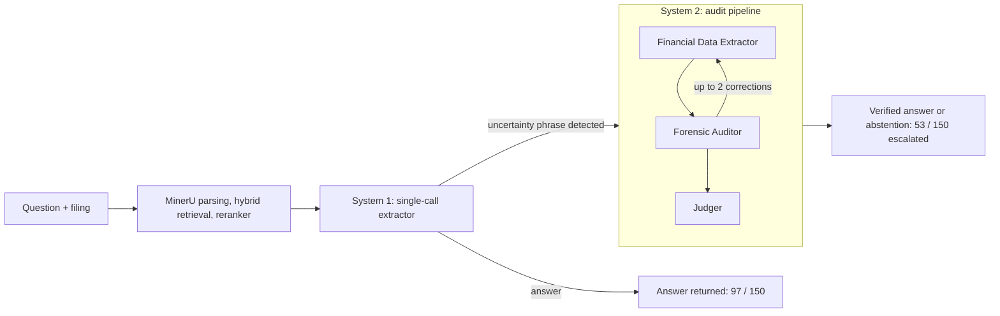

# Two-Stage RAG System for Financial Filing Question Answering

[](https://doi.org/10.5281/zenodo.23433986)

Research code and evaluation data for the paper **"Selective Escalation for Financial Filing Question Answering: A Cost–Quality Evaluation of a Two-Stage RAG System"** (Muştu & Altun, under review) and the underlying MSc thesis *"Thinking Fast and Slow in Finance: A Dual-Process Retrieval-Augmented Generation Architecture for Automated Financial Document Auditing"* (Boğaziçi University, 2026).

A single-call extractor (**System 1**) answers a question from retrieved filing context. When it signals insufficient evidence, the question is escalated to a three-agent audit pipeline (**System 2**: Financial Data Extractor → Forensic Auditor → Judger) that can also abstain. The repository contains the code for the retrieval front end, both stages, the cascade, and the evaluation outputs for the 150-question open-source [FinanceBench](https://arxiv.org/abs/2311.11944) sample.



## Main results (150 questions)

| | System 1 only | System 2 only | Cascade |
|---|---:|---:|---:|
| Exact match (EM) | 64 | 71 | 73 |
| Partial match (PM) | 18 | 21 | 24 |
| Incorrect | 11 | 21 | 21 |
| Abstention | 57 | 37 | 32 |
| Weighted accuracy (EM + 0.5·PM) | 48.7% | 54.3% | 56.7% |
| Total tokens | 585,356 | 2,056,170 | 1,253,024 |

The cascade escalated 53 of 150 questions. Cascade labels were audited in a validation workbook (8 exact matches downgraded to partial; the 32 abstentions could not be verified). Differences in accuracy lie within the sampling uncertainty of a 150-question benchmark; no significance test was run. Latency was measured in separate, uncontrolled runs and is not a reliable comparison. See the paper for details and limitations.

## Repository structure

```
code/   Pipeline code: code notebook
data/   Per-question outputs of the three configurations, necessary json files
```

## Method summary

- **Parsing:** filings are split into 30-page blocks and parsed with [MinerU](https://github.com/opendatalab/MinerU). Each text, list or table block becomes one retrieval unit. Tables are parsed into data frames and serialised row by row (`- <row label>: [<column header>: <value>] | ...`), with caption and footnotes. Every unit is prefixed with a `Company / Year / Report` header.
- **Retrieval:** per filing, separate text and table collections in in-memory ChromaDB (`BAAI/bge-small-en-v1.5`). BM25 + dense ensemble (20 candidates each; weights 0.4/0.6 for text, 0.7/0.3 for tables), re-ranked with `BAAI/bge-reranker-v2-m3` (top 5 for direct look-ups, top 10 for ratio / multi-step questions). Query-conditional HyDE for qualitative questions. Cover pages (0–4) and the primary financial statements are always injected.
- **Generator:** `qwen/qwen-2.5-72b-instruct` through the [OpenRouter](https://openrouter.ai) API, temperature 0, at most 2,000 new tokens per call. All stages use the same model; they differ only in prompts and pipeline logic.
- **Escalation rule:** System 1 is prompted to answer `INSUFFICIENT DATA` when evidence is incomplete or a multi-step calculation is needed. The cascade escalates when the response contains, case-insensitively, any of 11 uncertainty phrases (see `IDK_PHRASES` in the code). Routing is a fixed rule, not an agent decision.
- **System 2:** Extractor → Auditor loop (at most two correction cycles) → Judger. Prompts for all agents are in Appendix A of the paper.
- **Outcome labels:** EM, PM, INC (incorrect), ABS (abstention; labelled "Correct Rejection" in the thesis and system outputs, which records the decision, not its correctness).

## Setup

```bash
git clone https://github.com/snnmst/two-stage-rag-system.git
cd two-stage-rag-system
pip install -r requirements.txt      
cp .env.example .env                 # then add your OpenRouter API key
```


## Reproducibility notes

- Inference is hosted. No OpenRouter provider preference was set, so the upstream provider, its quantisation and its load were not controlled, and results are not guaranteed to be bit-for-bit reproducible even at temperature 0. Record the run date when re-running.
- Token counts are the prompt + completion tokens reported by the API for the System 1 / System 2 generation calls. HyDE calls are not included, and a response without usage metadata counts as zero.
- Prompts, the uncertainty-phrase list and answer post-processing were refined during development on the same benchmark; reported figures may be optimistic for unseen questions.
- Labels were produced with rule-based checks, cross-validated with two LLM assistants, and reviewed item by item by the first author.

## Data and licensing

- Code: MIT License (see `LICENSE`).
- `data/` contains the outputs and annotations produced in this study. FinanceBench questions, reference answers and source filings remain under their original terms; please check the FinanceBench license before redistributing them. 

## How to cite

If you use this repository, please cite the archived release (see `CITATION.cff`) and the paper once published:

```bibtex
@software{mustu_two_stage_rag_2026,
  author    = {Mu{\c{s}}tu, Sinan and Altun, H{\"u}seyin Oktay},
  title     = {Two-Stage RAG System for Financial Filing Question Answering},
  year      = {2026},
  publisher = {Zenodo},
  version   = {v1.0.0},
  doi       = {10.5281/zenodo.23433987},   
  url       = {https://github.com/snnmst/two-stage-rag-system}
}
```

## Authors

- Sinan Muştu ([ORCID 0009-0001-3051-4067](https://orcid.org/0009-0001-3051-4067)), Boğaziçi University, Institute for Data Science and Artificial Intelligence
- Hüseyin Oktay Altun ([ORCID 0000-0002-8875-6878](https://orcid.org/0000-0002-8875-6878)), Boğaziçi University, Institute for Data Science and Artificial Intelligence

## AI-assistance disclosure

Large language model assistants (including Claude, Gemini and ChatGPT) were used for code scaffolding and drafting. All assistant output was reviewed, verified and, where appropriate, rewritten by the authors, who take full responsibility for the work.
